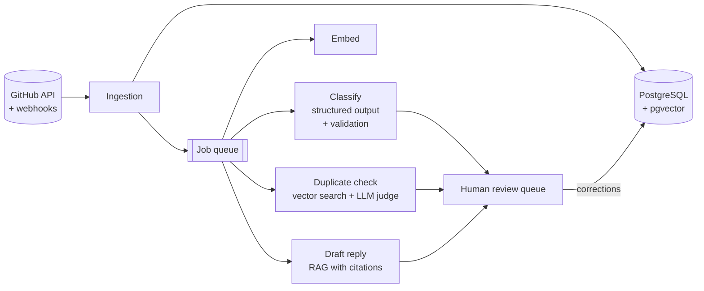

# AI Issue Triage

A Spring Boot service that triages GitHub issues for a large open-source project. It classifies issues, finds likely duplicates and drafts replies, and it routes every suggestion through a human review queue. Its accuracy is **measured** against labels the project's maintainers applied.

> 🚧 **Status: Phase 0 (foundations) in progress.** Progress is tracked in [docs/ROADMAP.md](docs/ROADMAP.md).

## What it does

- **Imports** issues from [spring-projects/spring-boot](https://github.com/spring-projects/spring-boot) through the GitHub REST API, handling pagination, rate limits and incremental sync; webhooks pick up new issues.
- **Classifies** each issue as bug, enhancement, documentation, question or invalid. The LLM's structured output is mapped to a Java record, validated, retried when invalid, and routed by calibrated confidence.
- **Finds duplicates** in two stages: a vector search in PostgreSQL/pgvector, then an LLM judge over the top candidates.
- **Drafts replies** grounded in similar resolved issues, with links to the sources. Nothing is posted without approval.
- **Measures itself:** a separate evaluation harness reports precision, recall, cost and latency for every prompt and model version, compared against simple baselines.

## Why

Maintainers of popular projects spend hours sorting incoming issues. Spring Boot's maintainers have already labelled thousands of issues: about 4,800 bugs, 4,300 enhancements, 3,100 documentation issues and 2,000 duplicates. Those labels are real ground truth, so this project can report honest accuracy numbers instead of demos that only *look* convincing.

## How it works



Details: [docs/DESIGN.md](docs/DESIGN.md)

## Results

*To be filled in by the evaluation harness. No number here will be made up.*

| Classifier | Model | Macro-F1 (test, n≈300) | Coverage @ 95% precision | $ / 1k issues | p50 latency |
|---|---|---|---|---|---|
| Majority-class baseline | n/a | | n/a | $0 | |
| Keyword baseline | n/a | | n/a | $0 | |
| kNN over embeddings | embedding model | | | | |
| LLM, prompt v1 | | | | | |
| LLM, final prompt | | | | | |

How these numbers are produced: [docs/EVALUATION.md](docs/EVALUATION.md)

## Tech stack

| Area | Choice |
|---|---|
| Language and framework | Java 25, Spring Boot 4.2, Maven |
| Data | PostgreSQL 18 + pgvector, Flyway, Spring Data JPA, JdbcClient |
| AI | Spring AI 2.1: local models via Ollama by default (**runs at $0**), hosted Claude models implemented behind the `cloud` profile, in-process ONNX embeddings, structured output |
| Background work | Postgres-backed job queue (`FOR UPDATE SKIP LOCKED`), virtual threads, Resilience4j |
| UI | Thymeleaf + htmx (server-rendered) |
| Testing | JUnit, AssertJ, Mockito, Testcontainers, ArchUnit, plus a separate eval harness |
| Delivery | Docker Compose, GitHub Actions, Cloud Native Buildpacks |

The reason behind each choice is recorded in [docs/adr](docs/adr/).

## Getting started

*Available after Phase 0 of the roadmap.* Planned:

```powershell
# Prerequisites: JDK 25, Docker Desktop, Ollama, a GitHub token in GITHUB_TOKEN
# No paid API key needed: the default profile uses free local models
.\mvnw.cmd verify            # build + tests (no real LLM or GitHub calls)
.\mvnw.cmd spring-boot:run   # starts PostgreSQL via Docker Compose automatically
```

## Documentation

| Document | Contents |
|---|---|
| [DESIGN](docs/DESIGN.md) | Goals, architecture, data model, AI pipeline, security, cost |
| [ROADMAP](docs/ROADMAP.md) | Step-by-step plan with progress |
| [EVALUATION](docs/EVALUATION.md) | Datasets, metrics, baselines, experiment log |
| [ADRs](docs/adr/) | Architecture decisions and their trade-offs |
| [RESOURCES](docs/RESOURCES.md) | Curated official documentation |

## How AI tools were used to build this

AI coding assistants help with this project (see [CLAUDE.md](CLAUDE.md) for the rules they follow). This section will describe what they did, what was reviewed or rewritten by hand, and why. Every line in this repository is code the author understands and can explain.

## Data and licence

Issue data comes from the public [spring-projects/spring-boot](https://github.com/spring-projects/spring-boot) repository through the GitHub API. The repository stores issue numbers and labels for evaluation, not issue text. Licence: [MIT](LICENSE).
